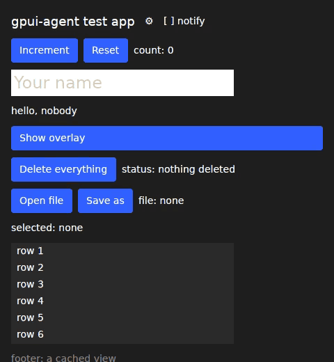
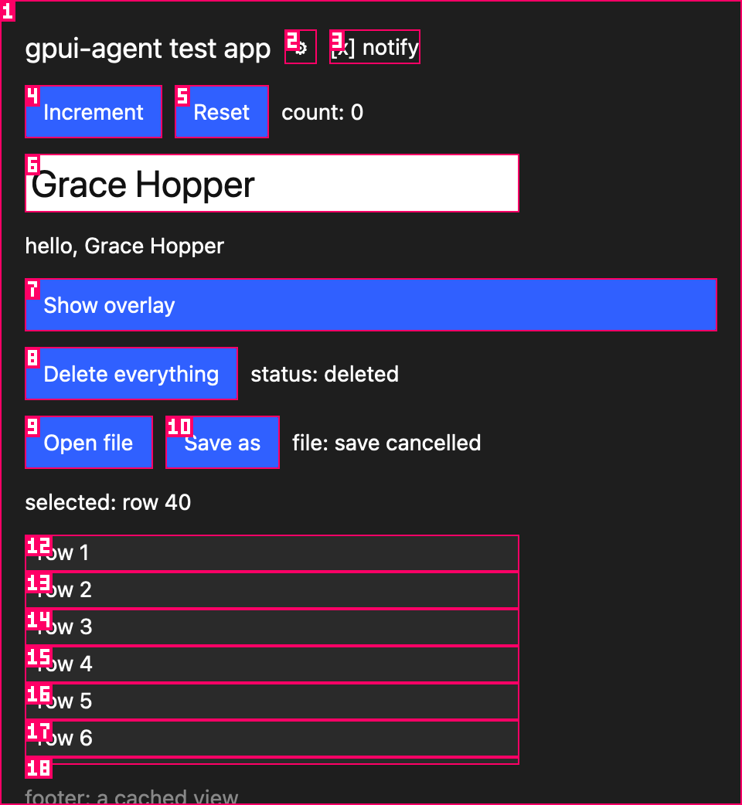

# gpui-agent

See and drive a [GPUI](https://www.gpui.rs) app from the command line, the way agent-browser drives
a web page. Built for coding agents that need to check the UI they just wrote.

```
$ gpui-agent launch -- ./target/debug/my-app
$ gpui-agent snapshot -i
window 4294967297 "gpui-agent testapp" 480x521
  @e1 group "root" ctx=TestApp [focused]  testapp/src/main.rs:59
    @e2 button "Settings"  testapp/src/main.rs:87
    @e3 checkbox "Notify me" [unchecked]  testapp/src/main.rs:99
    @e4 button "Increment"  testapp/src/main.rs:46
    @e6 textbox "Your name" ctx=TextInput  testapp/src/input.rs:632
    @e7 button "Show overlay"  testapp/src/main.rs:46
$ gpui-agent click @e4
clicked @e4 button "Increment"
$ gpui-agent fill @e6 "Ada"
filled @e6 with "Ada"
```

Every line names the source location that built the element, so an agent goes straight from what
it sees to the code that drew it.

<p align="center">
  
</p>

<p align="center"><sub>Recorded with <code>gpui-agent record</code> under Xvfb, from the app's own frames.</sub></p>

## Why

A GPUI window is one GPU surface. There is no DOM, no Chrome DevTools Protocol, nothing for
Playwright to attach to, and GPUI's accessibility tree only lists elements an app has labelled by
hand. gpui-agent adds a small record to GPUI of what each frame drew, serves it from inside the
app, and gives agents the commands they know from browser automation:

- an outline of the screen with refs, roles, text, states and source locations
- clicks, typing through the app's own text input handlers, keys, scrolling, drags
- waits for elements, text and a still frame
- screenshots and recordings rendered by the app itself, so they work under Xvfb, on a locked
  Mac, and in CI without a GPU
- prompts and open or save panels the agent can answer
- GPUI actions by name, and probes for app state
- a command line for scripts and tests, and the same commands as an MCP server

## Installation

### Command line

```bash
cargo install --locked --git https://github.com/wsp-labs/gpui-agent gpui-agent-cli
gpui-agent --version
```

The command line does not depend on GPUI and builds in under a minute.

### Linux dependencies

Headless runs start a private Xvfb, and recordings use ffmpeg:

```bash
sudo apt-get install -y xvfb ffmpeg
```

For software rendering on machines with no GPU, also install `mesa-vulkan-drivers` (lavapipe).

### Requirements

- Rust 1.98 or newer, the version Zed builds with (`rust-toolchain.toml`). On a Mac with
  Homebrew's Rust installed, put `~/.cargo/bin` first on `PATH`.
- A GPUI app built on a patched GPUI. See below.

## Add it to your app

gpui-agent needs a few additions inside GPUI, so your app builds against a patched copy. The
patches only add things, and they record nothing until the tool connects.

**1. Patch GPUI.** Pick the GPUI your app uses.

On Zed's GPUI from git, check out Zed at the commit in [`patches/gpui/BASE`](patches/gpui/BASE),
apply the patches, and point Cargo at that copy:

```bash
git clone https://github.com/zed-industries/zed ../zed
git -C ../zed checkout "$(cut -d' ' -f2 patches/gpui/BASE)"
git -C ../zed am "$PWD"/patches/gpui/*.patch
```

```toml
[patch."https://github.com/zed-industries/zed"]
gpui = { path = "../zed/crates/gpui" }
```

On gpui-kit, or anything pinned to crates.io's `gpui-pre 0.3.9`: unpack `gpui-pre`,
`gpui-pre-wgpu` and `gpui-pre-linux` 0.3.9, apply each crate's patch from
[`patches/gpui-pre-0.3.9`](patches/gpui-pre-0.3.9), and point `[patch.crates-io]` at them.
[`scripts/gpui-pre.sh`](scripts/gpui-pre.sh) does exactly this, checksums included. If your app
already carries its own GPUI patches, apply these on top; `git apply -3` merges them.

**2. Add the crate**, behind a feature so release builds never contain it:

```toml
[features]
agent = ["dep:gpui-agent", "gpui/test-support"]

[dependencies]
gpui-agent = { git = "https://github.com/wsp-labs/gpui-agent", optional = true, default-features = false, features = ["zed"] }
```

Use the `gpui-pre-0-3-9` feature instead of `zed` on gpui-kit. Screenshots need GPUI's
`test-support` feature (and `gpui_platform`'s, on Linux).

**3. Start it:**

```rust
application().run(|cx| {
    #[cfg(feature = "agent")]
    gpui_agent::init(cx);
    // your app as usual
});
```

`init` does nothing unless the app was started by `gpui-agent launch`, or with `GPUI_AGENT=1`.

**4. Optionally expose state**, so agents can check it without reading pixels:

```rust
gpui_agent::probe(cx, "open_file", move |cx| serde_json::json!(editor.read(cx).path()));
```

## Quick start

```bash
gpui-agent launch -- ./target/debug/my-app   # start it and wait until it answers
gpui-agent snapshot -i                       # what can be clicked or typed into
gpui-agent click @e4                         # act on a ref
gpui-agent wait --idle                       # let the app settle
gpui-agent screenshot --annotate shot.png    # check it looks right
gpui-agent close
```

## Commands

### Launch and sessions

```bash
gpui-agent launch -- ./app                   # start an app; a private Xvfb on Linux with no display
gpui-agent launch --headless -- ./app        # force Xvfb
gpui-agent launch --env RUST_LOG=info -- ./app
gpui-agent close                             # stop the app and its Xvfb
gpui-agent list                              # apps started with GPUI_AGENT=1
gpui-agent attach my-app                     # drive one of them, by name or pid
gpui-agent connect /tmp/app.sock             # an app started with GPUI_AGENT_SOCKET set
gpui-agent windows                           # the app's windows
gpui-agent select 4294967297                 # the window later commands act on
gpui-agent doctor                            # check the session, the app and this computer
```

### Read

```bash
gpui-agent snapshot                          # every element with text or input
gpui-agent snapshot -i                       # only elements that take input
gpui-agent snapshot -a                       # include clipped and scrolled-out elements
gpui-agent snapshot -d 2                     # stop at depth 2
gpui-agent snapshot -s @e11                  # only the subtree under @e11
gpui-agent snapshot --no-source              # leave out source locations
gpui-agent get text @e4                      # all text inside an element
gpui-agent get box @e4                       # its bounds in window pixels
gpui-agent get focus                         # the focused element
gpui-agent get count "row"                   # visible lines containing a text
gpui-agent get probe count                   # app state the app exposes
gpui-agent probes                            # the app's probe names
gpui-agent tree                              # the raw frame record as JSON
```

### Act

```bash
gpui-agent click @e4
gpui-agent click @e4 --right
gpui-agent dblclick @e4
gpui-agent hover @e4
gpui-agent fill @e6 "Ada"                    # click, then replace all the field's text
gpui-agent type @e6 " Lovelace"              # click, then insert at the cursor
gpui-agent type --keys "q"                   # one keystroke per character
gpui-agent press enter
gpui-agent press secondary-s                 # cmd on a Mac, ctrl elsewhere
gpui-agent scroll down 300 --on @e11
gpui-agent scrollintoview text:"row 40"
gpui-agent drag @e12 @e13
```

`fill` and `type` hand text to the field's input handler the way an input method does, so they
work whatever keys the app binds. Elements that read raw keys, such as a terminal, need `--keys`.

### Find

```bash
gpui-agent find text "Reset" click
gpui-agent find role button --name "Show" click
gpui-agent find id increment
gpui-agent find source main.rs:46
```

### Wait

```bash
gpui-agent wait @e4                          # until the element is on screen and visible
gpui-agent wait --text "Saved"               # until a visible line contains this
gpui-agent wait --gone "Loading"
gpui-agent wait --idle                       # until the frame stops changing for 300 ms
gpui-agent wait 500                          # plain milliseconds, a last resort
```

Waits give up after 25 seconds; `--timeout` takes milliseconds.

### Screenshots and recordings

```bash
gpui-agent screenshot shot.png
gpui-agent screenshot --annotate map.png     # numbered boxes; [N] is @eN, legend printed
gpui-agent screenshot --element @e4 b.png    # one element
gpui-agent record start --fps 15
gpui-agent record stop demo.mp4              # or demo.gif; needs ffmpeg
```

### Actions

GPUI apps are built on actions, and running one by name is often more reliable than clicking:

```bash
gpui-agent actions                           # actions at the focused element, with key bindings
gpui-agent action testapp::Reset
gpui-agent action editor::MoveDown '{"count": 3}'
```

### Prompts and file panels

While the tool drives an app, `window.prompt` draws inside the window, so its buttons appear in
the snapshot and `click` answers them; the snapshot header says `[prompt open]`. Open and save
panels never appear: queue the answer first.

```bash
gpui-agent pick ./report.txt                 # the next open or save panel answers this path
gpui-agent click text:"Open file"
gpui-agent pick                              # the next panel is cancelled
gpui-agent get picks                         # every panel the app asked for and what it got
```

### Help

```bash
gpui-agent skills get core                   # the full usage guide for this version
gpui-agent --help
```

## Snapshots

```
@e2 button "Settings"  testapp/src/main.rs:87
@e3 checkbox "Notify me" [unchecked]  testapp/src/main.rs:99
@e6 textbox "Your name" ctx=TextInput  testapp/src/input.rs:632
@e11 scroll "rows"  testapp/src/main.rs:242
  @e18 button "row 7" [clipped]  testapp/src/main.rs:249
```

- **Role** comes from what the element does: `button` has a click handler, `textbox` registered a
  text input handler, `scroll` scrolls, `group` takes focus, keys or raw mouse events, `overlay`
  only blocks the mouse, `text` is plain text. An accessibility role set with `.role(...)` wins.
- **Name** is the element's accessible label (`.aria_label("Settings")`) when it has one, else the
  text inside it, else its element id.
- **States** in brackets: `focused`, `clipped`, `disabled`, `checked`, `unchecked`, `mixed`.
- **`ctx=`** is the element's GPUI key context.
- **Source** is where the element was built, from GPUI's own `#[track_caller]` locations.

GPUI apps rarely label elements, so gpui-agent does not need them to: every element GPUI drew is in
the record, with its text and what it responds to.

## Refs and targets

Refs come from snapshots and stay attached to their element for the whole session. An element
keeps its `@eN` across later snapshots, finds and annotated screenshots as long as it is on screen,
found by the element ids above it, where it was built, and its type. When it is gone the command
fails and says so.

Commands that take a target accept:

| Target | Meaning |
| --- | --- |
| `@e4` | a ref from a snapshot |
| `id:increment` | an element id, or the end of an id path such as `rows/row-40` |
| `text:Reset` | an element named by its text, exact match first |

Clicks refuse when the element is clipped away or something else would receive the mouse at its
center, and say what is in the way:

```
$ gpui-agent click @e4
error: @e4 (button "Increment") is covered by overlay "overlay" from testapp/src/main.rs:265; deal with that first
$ gpui-agent click text:"row 40"
error: text:row 40 (button "row 40") is not visible; `gpui-agent scrollintoview text:row 40` brings it into view
```

## Annotated screenshots

<p align="center"></p>

`screenshot --annotate` draws a numbered box on each element that takes input and prints a legend
(`[4] @e4 button "Increment"`), so a model reading the image knows what it can click.

## Sessions

Each session runs one app with its own socket, Xvfb, refs and logs. Parallel agents use different
sessions:

```bash
gpui-agent --session a launch -- ./app
gpui-agent --session b launch -- ./app
export GPUI_AGENT_SESSION="$(gpui-agent session id --prefix my-app)"   # one per git worktree
gpui-agent session list
```

Every command takes `--session`, `--window` and `--json`.

## Headless runs and locked screens

On Linux with no display, `launch` starts a private Xvfb, so agents and CI never touch anyone's
screen. Screenshots and recordings come from the app's own renderer, never from the screen, so they
show only that window, at its real scale.

On a Mac the window opens on screen without taking focus. When macOS stops drawing it, on a locked
screen or when it is hidden or minimized, gpui-agent draws the pending frame itself after 200 ms,
so snapshots, screenshots and recordings stay current. The test suites pass on a locked Mac.

## MCP server

```bash
gpui-agent mcp
```

```json
{ "mcpServers": { "gpui-agent": { "command": "gpui-agent", "args": ["mcp"] } } }
```

The tools are the same commands: `launch`, `close`, `snapshot`, `click`, `hover`, `fill`, `type`,
`press`, `scroll`, `drag`, `screenshot`, `record`, `wait`, `get`, `find`, `actions`, `action`,
`pick`, `windows`, `apps` and `doctor`. Each call runs the command line, so the two never drift
apart, and each takes an optional `session`. `screenshot` returns the PNG inline.

## Usage with agents

Point your agent at the guide for the installed version:

```bash
gpui-agent skills get core
```

Or add a line to your project's agent instructions:

```markdown
To check a UI change in the app, use gpui-agent: run `gpui-agent skills get core` first.
```

A typical loop after an agent edits a screen:

```bash
cargo build --features agent
gpui-agent launch -- target/debug/my-app
gpui-agent snapshot -i
gpui-agent click @e7
gpui-agent wait --text "Saved"
gpui-agent screenshot --annotate proof.png
gpui-agent close
```

## How it works

```
 agent ── shell or MCP ──▶ gpui-agent command line ── one JSON line per request ──▶ your app
                            sessions, Xvfb, refs,       over a Unix socket          gpui_agent::init
                            snapshots, waits,                                       answers on the
                            annotations, ffmpeg                                     GPUI main thread
```

- **[`patches/gpui`](patches/gpui)**: six changes to Zed's GPUI. While the tool is attached, GPUI
  records each frame's elements (bounds, element id, source location, key context, what they
  respond to, accessible label and states) and the text each element painted, and lists the
  focus handles with a text input. Tools can insert or replace the focused field's text. Linux
  windows get `render_to_image`, which macOS and Windows already had. A hook answers open and save
  panels.
- **[`patches/gpui-pre-0.3.9`](patches/gpui-pre-0.3.9)**: the same changes for the published
  `gpui-pre` crates that gpui-kit pins.
- **[`gpui/gpui-agent`](gpui/gpui-agent)**: the in-app crate. Serves windows, the frame
  record, input, screenshots, recordings, actions, probes and file panels.
- **[`crates/cli`](crates/cli)**: the `gpui-agent` command and its MCP server. No GPUI dependency.
- **[`crates/protocol`](crates/protocol)**: the messages between the two.
- **[`gpui/testapp`](gpui/testapp)**: a GPUI app with every case the tool handles: buttons, a
  real text field, a long list, a cached view, an overlay, a prompt, file panels, a labelled icon
  button and a checkbox.

## Platforms

| Platform | Status |
| --- | --- |
| Linux, X11 and Xvfb | Supported, tested |
| macOS | Supported, tested, including a locked screen |
| Linux, Wayland | Builds; screenshots untested |
| Windows | Not supported yet; the socket is a Unix socket |

| GPUI | Feature | Patches |
| --- | --- | --- |
| Zed's GPUI from git | `zed` | `patches/gpui` |
| `gpui-pre 0.3.9` (gpui-kit) | `gpui-pre-0-3-9` | `patches/gpui-pre-0.3.9` |

## Security

- The app serves nothing unless it was started by `gpui-agent launch` (which sets
  `GPUI_AGENT_SOCKET`) or with `GPUI_AGENT=1`.
- It listens on a Unix socket in the user's own state folder (`$XDG_RUNTIME_DIR/gpui-agent` or a
  per-user temp folder), never on a network port.
- Anyone who can open that socket can drive the app and read what it shows. Keep the crate behind
  a feature that release builds leave off, and check a release binary has no `gpui_agent` symbols.

## Testing

```bash
cargo test -p gpui-agent-cli                             # the command line, no GPUI needed
cargo build -p gpui-agent-cli
(cd gpui && cargo build -p gpui-agent-testapp)           # the test app on the patched Zed
scripts/e2e.sh target/debug gpui/target/debug            # 96 checks, every command
scripts/mcp_e2e.py target/debug gpui/target/debug        # 18 checks over MCP
scripts/e2e.sh "$(scripts/gpui-pre.sh /tmp/gpui-pre)"    # the same against gpui-pre 0.3.9
```

The repository holds two workspaces. The root one is the command line and the protocol, with no
GPUI, so installing it is quick. `gpui/` holds the in-app crate and the test app, and its `zed`
feature expects the patched Zed beside this repository, at `../zed`. Both suites pass on Linux under Xvfb against
Zed's GPUI, `gpui-pre 0.3.9`, and `gpui-pre 0.3.9` carrying another app's own GPUI patches, and on
macOS against both GPUIs.

## Known gaps

- GPUI's in-window prompt does not block clicks to the window behind it, so the tool reports
  `[prompt open]` but does not refuse those clicks.
- Upstream GPUI has no way to mark an element disabled, so `[disabled]` shows only for elements
  that report it themselves.
- X11 windows report an empty title, because GPUI's X11 backend does not implement `get_title`.

## License

Apache-2.0. The test app's text field comes from GPUI's `examples/input.rs`, also Apache-2.0.
